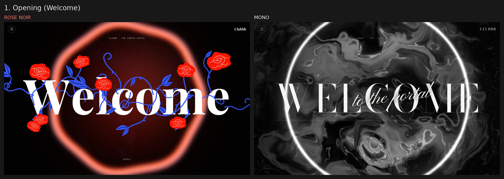
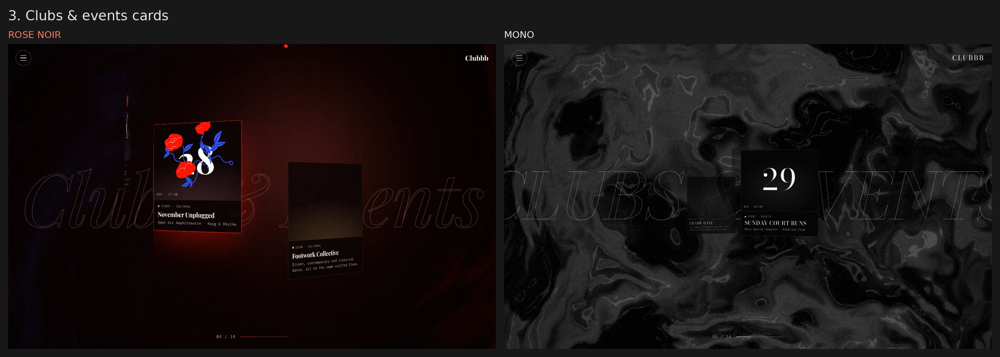
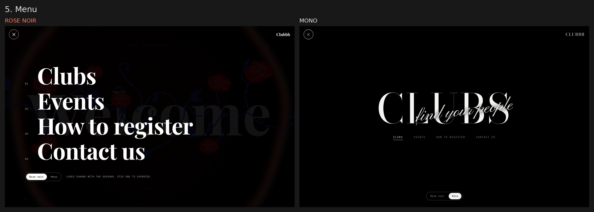
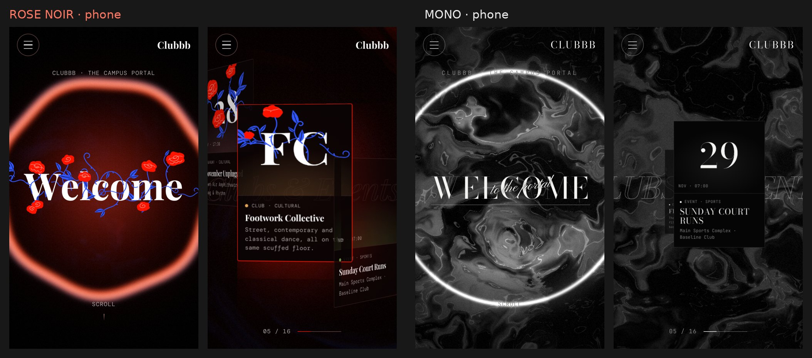

# Clubbb

A campus club portal with a living, animated front end. Clubs register and get a page
of their own, post events, and collect applications and RSVPs. Students scroll through
every club and event in a 3D spiral.

No build step, no npm, no accounts. Python 3 standard library and SQLite on the server;
plain JavaScript, canvas and WebGL in the browser.



## Run it on your computer

You need **Python 3.8 or newer** ([python.org/downloads](https://www.python.org/downloads/)).
On Windows, tick **"Add python.exe to PATH"** in the installer.

| System | How |
|---|---|
| Windows | Double-click `start.bat` |
| Mac / Linux | Double-click `start.sh`, or in a terminal: `./start.sh` |
| Any (manual) | `cd clubportal`, then `python3 seed.py` (first time only), then `python3 app.py` |

Then open **http://localhost:8770**. The first run fills the site with 8 demo clubs and
14 demo events. Stop the site with `Ctrl + C` in the terminal, or close its window.

The terminal also prints:
- an **admin link** (`/admin?key=…`) to approve new clubs and change the campus code. Keep it private.
- the **campus code** students need (see Access below).

Demo clubs can log in at **Club login** with their email (e.g. `hello@codecell.example.com`)
and the password `clubbb-demo`.

## Access

Two kinds of access, both free, with no outside services:

| Who | How | What it unlocks |
|---|---|---|
| **Everyone** | nothing | Browsing clubs, events and club pages |
| **Students** | the **campus code**, typed once (the browser remembers it for 6 months) | RSVP, applying to a club, reminders, registering a club |
| **Club organisers** | **Club login** with the club email and a password | The club dashboard: edit the page, post events, see applications and RSVPs |

- Share the campus code on posters, at orientation and in class groups. First-years can use it
  on day one; no college email or USN needed.
- Change the code from the admin page each semester. Everyone types the new one once.
- Organisers set their password when registering. A one-time backup link is also shown, in case
  they forget it; from the backup link they can set a new password.
- Passwords are stored hashed (PBKDF2); sessions use signed cookies; repeated wrong logins are
  slowed down.

## What is in it

**Pages**
- **Home**: a portal opens and "Welcome" grows; scrolling blooms a transition into a 3D
  spiral of clubs and events, then two doors: Clubs and Events.
- **Clubs / Events**: one huge word, then the spiral of cards.
- **A club page**: name, description, its events, and an "Apply to join" form.
- **An event page**: details, RSVP, reminders, and what else is on at the same time.
- **How to register / Contact us**: reached from the menu (three lines, top left).
- **Club dashboard**: edit the page, upload a landscape club photo, post events (with a cover
  photo), and read applications. Photos of any size work: big ones are shrunk in the browser
  (to 2000 px) before upload. A card with a photo shows it as its face in the spiral, wider than
  the other cards, and the photo is shown wide on the club or event page.
- **Admin**: approve clubs.

**Reminders**
- **Add to calendar**: Google Calendar link and an `.ics` file (Apple, Outlook) on every event,
  with alerts a day and an hour before. Each club has a feed at `/c/<club>/calendar.ics`, and
  the whole site at `/calendar.ics`.
- **Remind me on this site**: saved in the visitor's browser; a "Starts in 2 h" card pops up
  on their next visit (and a browser notification if they allow it).
- **Email**: once you connect an email account (see Settings), visitors can type their email
  for a reminder a day and an hour before, and everyone who RSVPs gets them too. Each email
  has a one-click stop link.
- Events today or tomorrow get a **Today / Tomorrow** tag on their card.

**Moments: winners and memories**
- After an event, organisers share up to 8 photos, the winners (1st, 2nd, 3rd, other mentions)
  and a caption from their dashboard. Large phone photos are shrunk in the browser first.
- **Their own event**: on the home page under "Moments" for two weeks, then kept for good on the
  club's page under "Memories" (and on the event's page).
- **An outside event** (say, members winning an inter-college contest): on the home page for one week.
- Photos open full size on tap. Clubs can delete their own posts; the admin page can delete any.

**Clash checking**
- While a club fills in a new event, the form checks every club's events as they type.
  **Same venue at the same time** is flagged red; other events at that time are listed.
- If there is a clash, the event is held back until the club ticks "I have seen the clash"
  and publishes again.
- The club dashboard lists its upcoming events with clash tags, RSVP and reminder counts.
- Event pages show "Also happening at the same time".

**Layout signatures** (each theme lays the page out differently)
- **Rose noir — the vine:** below the spiral, a stem grows down the left edge as you scroll, with
  leaves and buds along the way. At each section it branches out toward the content and a rose
  opens as you arrive. Plain SVG lines, so it costs almost nothing. On phones the roses bloom on
  the stem in the margin.
- **Mono — editorial:** sections get a magazine index line ("01 — Moments") with a rule that
  draws across; Moments become a vertical feature list with photos alternating sides; the
  Clubs / Events doors stack as full-width rows; register steps use large numerals.

**Potato mode** (for phones that struggle)
- A still, light version with its own look: no WebGL, no 3D spiral, no transitions or particles.
  The rose lettering is drawn once as a still picture, cards sit in a plain grid with a rose stamp,
  and a small "potato" badge sits next to the logo.
- Turns on automatically for phones with 2 GB of memory or less, data saver on, a 2G connection,
  or "reduce motion" switched on. If the full site stutters in the first few seconds, the site
  offers to switch.
- Menu → Potato mode: Auto / On / Off (remembered on that device).

**Two looks** (switch in the menu)

| | Rose noir | Mono |
|---|---|---|
| Type | Playfair Display, bold | Bodoni Moda capitals + Pinyon Script |
| Background | an unfurling rose of petal outlines over a red glow (WebGL) | black-and-white liquid chrome (WebGL) |
| Headings | roses and vines grow out of the letters | letters rise in, a script word writes across |
| Cards | 3D spiral of landscape cards (no mouse tilt); hover reveals details over a bed of roses (or the photo) | cards fly toward you through a tunnel |
| Touch | tap the big heading for a butterfly | none: the background flows on its own |
| Page change | roses bloom over the page | halftone dots close over the page |





More in [`docs/screenshots`](docs/screenshots).

## Change the look by season

Open `clubportal/app.py` and find `SEASONS`. It has one entry per month, January to
December. Each month picks a theme (`"rosenoir"` or `"mono"`):

```python
SEASONS = ["rosenoir"] * 12                      # Rose noir all year (current)
SEASONS = ["mono", "mono", "rosenoir", "rosenoir", "rosenoir", "rosenoir",
           "rosenoir", "rosenoir", "rosenoir", "mono", "mono", "mono"]  # example
```

Visitors can still override it from the menu; their choice is remembered.

## Settings

Set these as environment variables before starting (all optional):

| Variable | Default | What it does |
|---|---|---|
| `PORT` | `8770` | Port the site listens on |
| `HOST` | `127.0.0.1` | Use `0.0.0.0` to allow other devices on your network |
| `ADMIN_KEY` | random, saved in `clubportal/.admin_key` | Key for the admin page |
| `CAMPUS_CODE` | random, saved in `clubportal/.campus_code` | Fixes the campus code (then it can't be changed from the admin page) |
| `CONTACT_EMAIL` | `hello@clubbb.example` | Address shown on the Contact page |
| `SITE_URL` | `http://localhost:8770` | Public address, used in reminder emails and calendar files |
| `SMTP_HOST` | (empty: email off) | Mail server, e.g. `smtp.gmail.com`. Setting it switches email reminders on |
| `SMTP_PORT` | `587` | Mail server port (STARTTLS) |
| `SMTP_USER` / `SMTP_PASS` | | Login for the mail server. For Gmail, use an [app password](https://support.google.com/accounts/answer/185833) |
| `SMTP_FROM` | `SMTP_USER` | The "from" address on reminder emails |
| `PORTAL_DB` | `clubportal/portal.db` | Where the database file lives |

Email example (Mac/Linux):

```bash
cd clubportal
SMTP_HOST=smtp.gmail.com SMTP_USER=you@gmail.com SMTP_PASS='app-password' \
SITE_URL=https://clubs.your-college.edu python3 app.py
```

On Windows (Command Prompt), run `set SMTP_HOST=smtp.gmail.com` (and the others) first, then
`python app.py`. Reminders only go out while the site is running.

## Project layout

```
clubbb/
├── start.bat / start.sh      one-click start
├── clubportal/
│   ├── app.py                server, database and every page's HTML
│   ├── seed.py, seed.json    demo clubs and events (dates move with today)
│   ├── static/
│   │   ├── garden.js         the Type Garden drawing engine (roses, vines, butterflies, Mono type)
│   │   ├── portal.js         WebGL backgrounds, menu, scroll curtain, spiral/tunnel, petals
│   │   └── style.css         both themes
│   ├── Dockerfile            container build
│   └── clubportal.service    systemd unit for a Linux server
├── extras/
│   ├── typegarden.html       standalone Type Garden (type to grow roses)
│   └── vision.html           one-page project pitch
└── docs/                     screenshots and the original build spec
```

## Hosting

Any machine that runs Python 3.8+ and stays on.

```bash
cd clubportal
HOST=0.0.0.0 PORT=8080 ADMIN_KEY='something-long' python3 app.py
```

Put Nginx or Caddy in front for HTTPS. With Docker:

```bash
cd clubportal
docker build -t clubbb .
docker run -p 8770:8770 -v "$PWD/data:/data" -e ADMIN_KEY=change-me clubbb
```

GitHub Pages will **not** run this: it only serves static files, and Clubbb needs its
Python server for forms and the database.

## Credits

- The rose drawing engine in `static/garden.js` and `extras/typegarden.html` is a port of
  **Type Garden** by **Akshat Agarwal** ([type-garden.vercel.app](https://type-garden.vercel.app)).
  If you publish this repository, keep this credit and check with the author about reuse.
- Fonts from Google Fonts: Playfair Display, Bodoni Moda, Pinyon Script, DM Mono, JetBrains Mono.
- Demo clubs and events are fictional.
